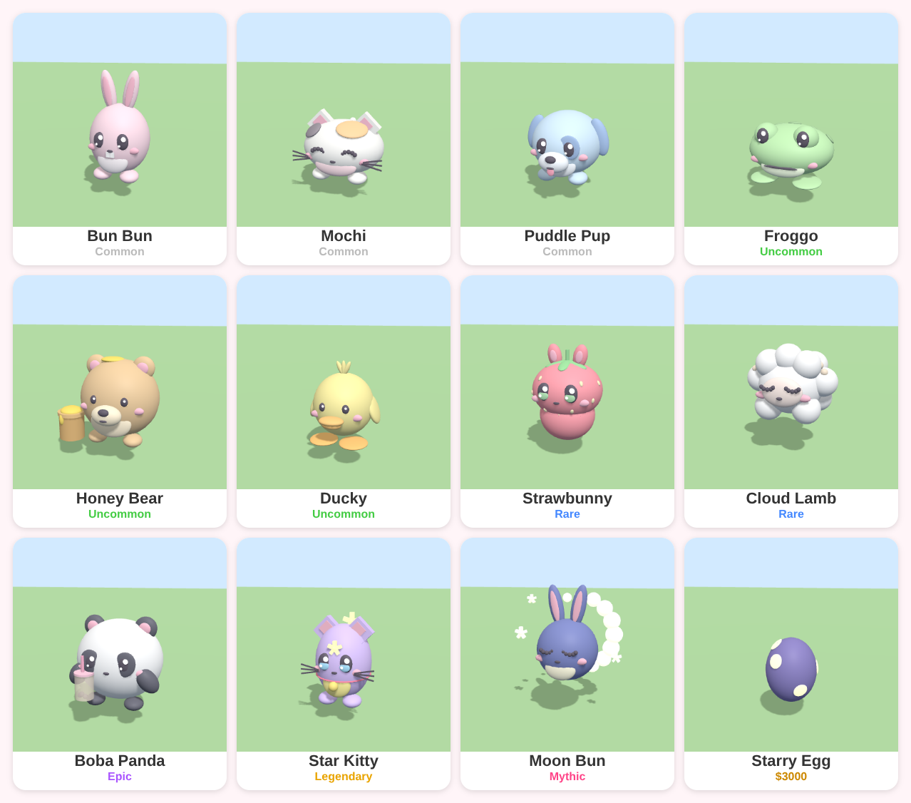
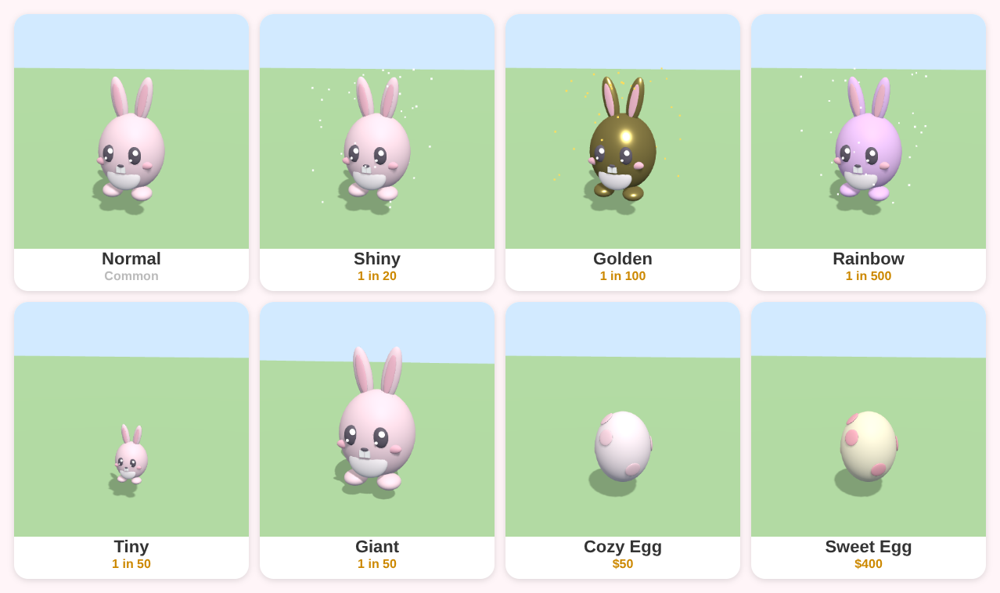
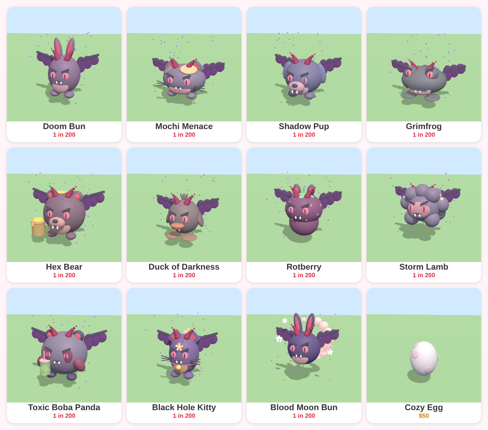
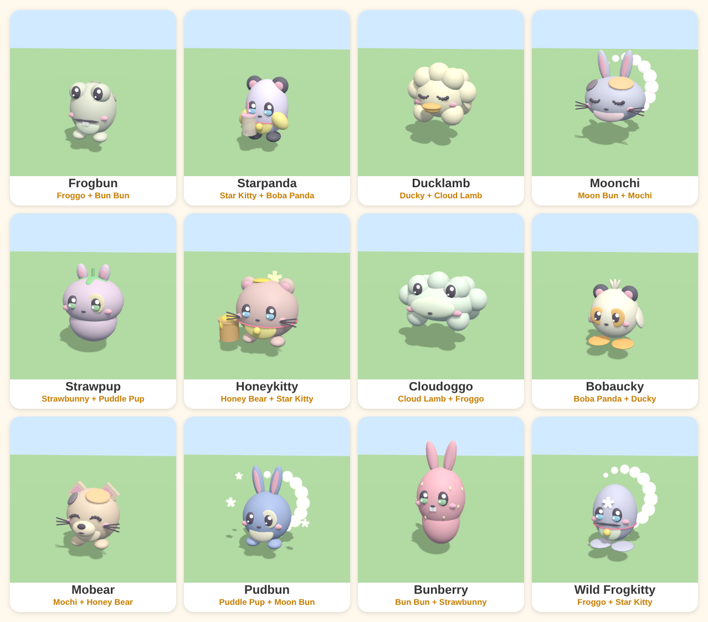

# Plushie Pals (working title)

A cute "hatch, grow and trade" Roblox game. Read [GAME_DESIGN.md](GAME_DESIGN.md) for the pets and systems, and [GAME_IDEAS.md](GAME_IDEAS.md) for the world, gameplay, events and build order.

## What's here
| File | What it does |
|---|---|
| `src/shared/PetData.lua` | All pets, eggs, rarities, mutations + hatch-roll functions |
| `src/shared/ModelBuilder.lua` | Builds the cute pet & egg models out of Parts (no meshes needed) |
| `src/shared/PetMixer.lua` | The Plush Mixer: mixes two pets into a one-of-a-kind baby (DataStore-ready "genes") |
| `src/shared/PetAnimator.lua` | Bouncy/wiggle animation + Rainbow color cycling |
| `src/server/Showcase.server.lua` | Spawns every pet, mutation and egg so you can look at them |

## How to open it in Roblox Studio
**Option A: Rojo (recommended)**
1. Install [Rojo](https://rojo.space) and the Rojo Studio plugin.
2. Run `rojo serve` in this folder.
3. In Studio, open a Baseplate, click **Connect** in the Rojo plugin, then press **Play**.

**Option B: copy & paste**
1. In `ReplicatedStorage`, make a Folder named `Shared`.
2. Inside it, add 4 **ModuleScripts** named `PetData`, `ModelBuilder`, `PetAnimator`, `PetMixer` and paste each file in.
3. In `ServerScriptService`, add a **Script** and paste `Showcase.server.lua`.
4. Press **Play** and walk forward: 5 rows (pets, evil pets, mutations, Plush Mixer babies, eggs). The mixer babies are different every time you press Play.

## Adding a new pet
Add an entry to `PetData.Pets` (colors, ears = `Round`/`Pointy`/`Long`/`None`, optional `Extra`), then add it to an egg's `Pets` table.

## Preview
These are preview renders made from the same shapes and colors as `ModelBuilder.lua`, not Studio screenshots. Lighting and materials will look a little different in Roblox.

